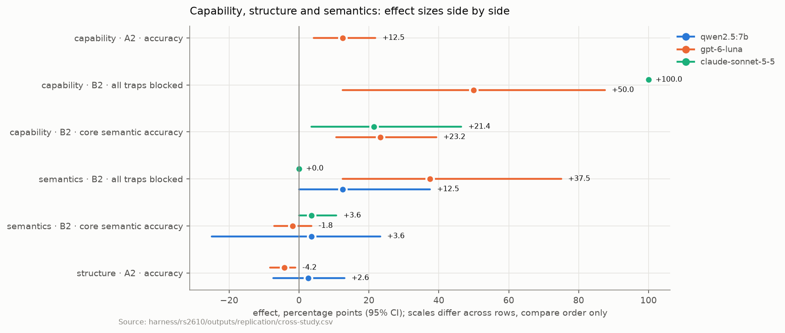

# WHAT ACTUALLY IMPROVES TABULAR AI DECISIONS?

This page compares three levers, within the experiments in this repository: a more **capable model**, more
**reasoning structure** (topology), and more **semantic context** (documentation). It adds no new analysis. Every
entry below is a result reported in a study README or report, and the order of the levers comes from the
pre-registered comparison in section 8 of the replication report.

## Compact matrix

| lever | Study A / A2 (bounded AutoML decisions) | Study B / B2 (semantic decisions, traps) | JEV (typed bounded-decision model) |
|---|---|---|---|
| **capability** | `gpt-6-luna` − `qwen2.5:7b` at DIRECT: +12.5 pp accuracy [+4.2, +21.9], Holm p < 0.001 | at A_RAW, all traps blocked 12.5% → 62.5% (`gpt-6-luna`) / 100.0% (`claude-sonnet-5-5`), descriptive | not tested (one model version) |
| **structure** | no gain on `qwen2.5:7b` (Study A and A2); on `gpt-6-luna` every topology worse than DIRECT, GoT −21.9 pp, Holm p < 0.001 | — | decomposition (E) added nothing on unseen data |
| **semantics** | — | Study B (`qwen2.5:7b`): all traps blocked 43.8% → 93.8% with rules, Holm p 0.046; B2: decisive with anonymized names (`gpt-6-luna` 0.0% → 100.0%, Holm p 0.031), small with meaningful names on capable models | v1: EXPLANATION_MODE 22.6% → 58.1% (A → B); on 6 unseen datasets richer semantics (C) and structured state (D) added nothing over B (0 of 14 tests significant) |

## Pre-registered comparison (A2, B2)

[`cross-study.csv`](cross-study.csv) (canonical copy:
[`outputs/replication/cross-study.csv`](../../harness/rs2610/outputs/replication/cross-study.csv); code:
[`replication/cross.py`](../../harness/rs2610/replication/cross.py)). A2 intervals are instance-cluster bootstraps
with Holm-adjusted McNemar p. B2 intervals are paired bootstraps over (dataset, replicate) units with an unadjusted
exact sign p.

| axis | study, metric | `qwen2.5:7b` | `gpt-6-luna` | `claude-sonnet-5-5` |
|---|---|---|---|---|
| capability (frontier − baseline) | A2, DIRECT accuracy | (baseline) | +12.5 [+4.2, +21.9] | not run |
| capability | B2, A_RAW core semantic accuracy | (baseline) | +23.2 [+10.7, +39.3] | +21.4 [+3.6, +46.4] |
| capability | B2, A_RAW all traps blocked | (baseline) | +50.0 [+12.5, +87.5] | +100.0 [+100.0, +100.0] |
| structure (best non-DIRECT − DIRECT) | A2, accuracy | +2.6 [−7.3, +13.0] | −4.2 [−8.3, −1.0] | not run |
| semantics (D_RULES − A_RAW) | B2, core semantic accuracy | +3.6 [−25.0, +23.2] | −1.8 [−7.1, +3.6] | +3.6 [0.0, +10.7] |
| semantics | B2, all traps blocked | +12.5 [0.0, +37.5] | +37.5 [+12.5, +75.0] | 0.0 [0.0, 0.0] |

*Figure: the table above as dot-and-interval rows. Scales differ across rows; compare order only. Generated by
`tools/replication_figures.py`.*

## Reading, within these tests

**Ordinal answer: capability > semantics > structure.**

- **Capability** gave the largest gains on both benchmarks.
- **Semantic documentation** mattered where names alone were not enough: trap blocking with a weak model, and
  anonymized columns. Where the column names were meaningful, a capable model barely needed it for core accuracy.
  A false dictionary was caught by the hosted models far more often than by the 7B model.
- **Reasoning structure** added nothing on the 7B model and cost accuracy on the hosted model, mostly through
  abstentions.
- **JEV** is a different kind of model and is listed separately. On its original benchmark, typed semantics raised
  one decision type sharply. On six unseen datasets, richer semantics, structured state and decomposition added
  nothing over B. B itself was not re-tested against A there, so the JEV report does not claim that B's gain was
  dataset-specific.

## Not claimed

- That topology never helps. Only four orchestrations, these decisions and these models were tested.
- That documentation is unnecessary for capable models. It was decisive once names were anonymized, and B2 has
  4–8 units per cell.
- Anything about the providers' top tiers, or any equality from a non-significant test.
- That the three levers are independent or additive. No experiment varied all three together.

## Folders

- [analysis/](analysis/): code and canonical table
- [figures/](figures/): figure above
